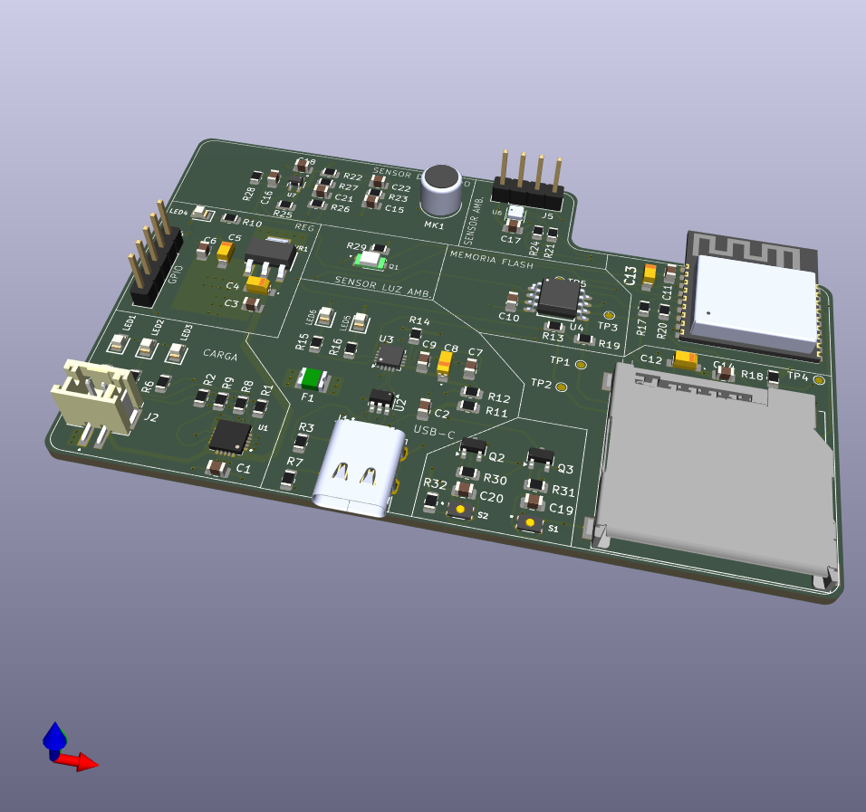
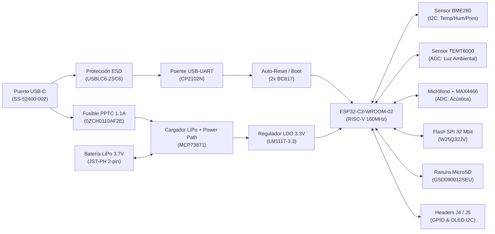
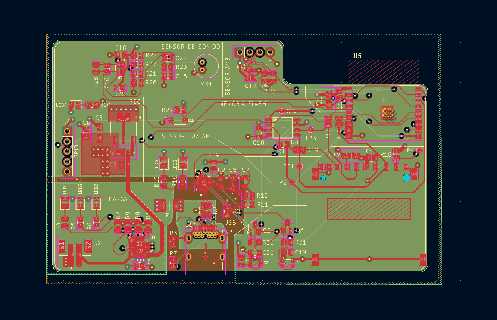
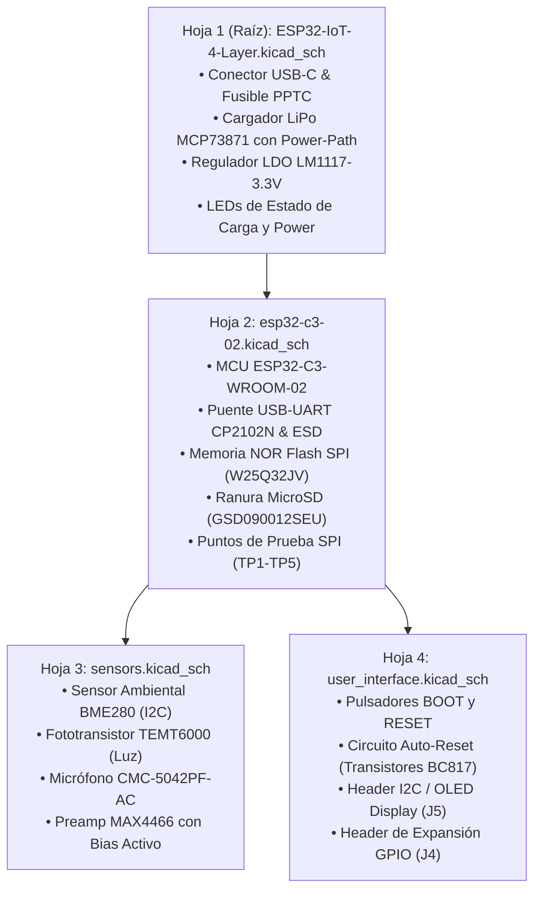

# ESP32-C3 4-Layer IoT Multisensor Board 🚀

[](https://www.kicad.org/)
[](#3-diseño-de-pcb-y-stackup-4-capas)
[](https://www.espressif.com/)
[](#5-herramientas-y-recursos-utilizados)
[](#)

Nodo IoT embebido multisensor de **4 capas**, compacto y de bajo consumo, basado en el microcontrolador **Espressif ESP32-C3-WROOM-02** (arquitectura RISC-V a 160 MHz con conectividad Wi-Fi 4 y Bluetooth 5 LE). 

El diseño integra una solución completa de gestión de energía con carga de batería LiPo y conmutación automática (*Power-Path Management*), interfaz USB-C nativa con puente USB-UART CP2102N y auto-reset, almacenamiento masivo local dual (Flash SPI externa de 32 Mbit + ranura MicroSD), sensor ambiental de alta precisión (temperatura, presión y humedad), fototransistor de luz ambiental y micrófono electret con etapa de preamplificación activa ajustable.

Este proyecto ha sido concebido bajo estrictas pautas de diseño electrónico profesional, cumpliendo con restricciones de compatibilidad electromagnética (EMC), integridad de señal (SI) para pares diferenciales USB y buses de alta velocidad, optimización térmica y validación DFM (*Design for Manufacturability*) para fabricación seriada.

---

## Render 3D del Hardware y Documentación

<p align="center">
  
</p>

* **Esquemático Completo:** [Ver / Descargar Esquemático en PDF](./ESP32-IoT-4-Layer-3D-Layout.pdf)
* **Visualización de PCB 3D:** [Ver / Descargar Vista 3D en PDF](./ESP32-IoT-4-Layer-3D-PCB.pdf)
* **Archivos Gerber y Taladros (NextPCB / HQ DFM):** [Descargar Paquete Gerber ZIP](./HQDMF/Gerber_ESP32-IoT-4-Layer.zip)

---

## Tabla de Contenidos
- [1. Descripción General del Proyecto](#1-descripción-general-del-proyecto)
- [2. Arquitectura de Hardware y Características Principales](#2-arquitectura-de-hardware-y-características-principales)
  - [2.1 Microcontrolador y Conectividad](#21-microcontrolador-y-conectividad)
  - [2.2 Gestión de Energía y Batería (Power-Path Management)](#22-gestión-de-energía-y-batería-power-path-management)
  - [2.3 Sensores Integrados](#23-sensores-integrados)
  - [2.4 Almacenamiento Local y Puntos de Prueba](#24-almacenamiento-local-y-puntos-de-prueba)
  - [2.5 Interfaz de Usuario y Cabezales de Expansión](#25-interfaz-de-usuario-y-cabezales-de-expansión)
- [3. Diseño de PCB y Stackup (4 Capas)](#3-diseño-de-pcb-y-stackup-4-capas)
  - [3.1 Distribución del Stackup y Dimensiones](#31-distribución-del-stackup-y-dimensiones)
  - [3.2 Enrutamiento de Señales Críticas y Pares Diferenciales USB](#32-enrutamiento-de-señales-críticas-y-pares-diferenciales-usb)
  - [3.3 Clases de Red (Net Classes) y Reglas de Diseño](#33-clases-de-red-net-classes-y-reglas-de-diseño)
  - [3.4 Consideraciones de RF y Planos de Cobre](#34-consideraciones-de-rf-y-planos-de-cobre)
- [4. Estructura del Repositorio y Hojas del Esquemático](#4-estructura-del-repositorio-y-hojas-del-esquemático)
- [5. Lista de Materiales (BOM Resumida)](#5-lista-de-materiales-bom-resumida)
- [6. Herramientas y Recursos Utilizados](#6-herramientas-y-recursos-utilizados)
- [7. Créditos y Referencias](#7-créditos-y-referencias)

---

## 1. Descripción General del Proyecto

La placa ha sido desarrollada como una plataforma integral de adquisición de datos en tiempo real y telemetría edge computing. Permite monitorear parámetros ambientales, acústicos y luminosos, procesarlos localmente en el núcleo RISC-V del microcontrolador y transmitirlos a la nube (AWS IoT Core, ThingsBoard, Home Assistant, servidores MQTT) mediante Wi-Fi o Bluetooth LE.



---

## 2. Arquitectura de Hardware y Características Principales

### 2.1 Microcontrolador y Conectividad
* **MCU:** Módulo **ESP32-C3-WROOM-02-H4** de Espressif Systems.
  * Núcleo: Procesador RISC-V de 32 bits y un solo núcleo a una frecuencia de hasta 160 MHz.
  * Memoria: 400 KB de SRAM interna, 384 KB de ROM y 4 MB de memoria Flash integrada en encapsulado SiP.
  * Conectividad RF: Subsistema Wi-Fi 802.11 b/g/n (hasta 150 Mbps) y Bluetooth 5 (LE) con antena PCB tipo MIFA integrada.
* **Interfaz USB-C:** Conector hembra reversible **SS-52400-002** (Bel Fuse) de 24 pines con resistencias de configuración de canal CC1/CC2 de 5.1 kΩ (`R3` y `R7`), garantizando compatibilidad con cargadores y puertos USB-C estándar (5 V @ hasta 3 A).
* **Supresión de Transitorios ESD:** Red de diodos de protección **USBLC6-2SC6** (`U2`, encapsulado SOT-23-6) de muy baja capacitancia parásita (<3.5 pF) para proteger las líneas `USB_DP`, `USB_DN` y el riel `VBUS` contra descargas electrostáticas de hasta ±15 kV por aire y ±8 kV por contacto (IEC 61000-4-2 nivel 4).
* **Puente USB a UART:** Circuito integrado **CP2102N-Axx-xQFN20** (`U3`, encapsulado QFN-20 de 3x3 mm) con soporte de velocidades de baudios de hasta 3 Mbaud.
  * Indicadores visuales de actividad de transmisión (`LED5` rojo para `TXT`) y recepción (`LED6` verde para `RXT`).
  * Resistencias de amortiguación en serie de 50 Ω (`R13` y `R17`) en las líneas UART para reducir reflexiones de alta frecuencia.
* **Circuito de Auto-Programación / Auto-Reset:** Implementado mediante dos transistores NPN discretos **BC817** (`Q2` y `Q3`) controlados por las señales `DTR` y `RTS` del CP2102N, permitiendo la conmutación automática entre modo normal y modo de descarga de firmware (control de líneas `EN` y `GPIO9/BOOT`) sin requerir pulsación manual de botones durante el flasheo desde el ESP-IDF o PlatformIO.

### 2.2 Gestión de Energía y Batería (Power-Path Management)
* **Controlador de Carga LiPo:** Circuito integrado **MCP73871-4CCI/ML** (`U1`, QFN-20 de 4x4 mm con pad térmico expuesto).
  * Algoritmo de carga completo en corriente constante / tensión constante (CC/CV) con corte a 4.20 V.
  * **Power-Path Management Automático:** Conmuta de forma transparente el riel del sistema entre la entrada de alimentación externa (USB de 5 V) y la batería LiPo. Si la corriente de carga y consumo supera el límite provisto por USB, la batería asiste automáticamente al riel del sistema sin reiniciar el microcontrolador.
  * Monitoreo térmico mediante red resistiva simulando termistor NTC (`Net-(U1-THERM)`).
* **Conexión de Batería:** Conector de montaje superficial **JST B2B-PH-SM4-TB** (`J2`) con paso de 2.0 mm para baterías de polímero de litio (LiPo) de una celda (1S, 3.7 V nominal).
* **Protección de Entrada:** Fusible rearmable de coeficiente de temperatura positivo polimérico (PPTC) **0ZCH0110AF2E** (`F1`, tamaño 1210), con corriente de mantenimiento ($I_H$) de 1.10 A y tensión nominal de 16 V, protegiendo el hardware ante sobrecorrientes en el bus USB.
* **Regulación a 3.3 V:** Regulador lineal LDO de bajo dropout **LM1117MPX-3.3/NOPB** (`VR1`, encapsulado SOT-223) capaz de suministrar hasta 800 mA con excelente rechazo al rizado (PSRR).
  * Red de filtrado con condensadores de tantalio de baja ESR **10 µF** (`C4`, `C5`, `C12`, `C13`, encapsulado EIA 3216 / KEMET T491A) y cerámicos multicapa (MLCC) de desacoplo de alta frecuencia de **0.1 µF** y **1 µF**.
* **LEDs de Diagnóstico y Estado:**
  * `LED1` (Rojo): Indicador de batería en proceso de carga (`/CHARGING`, pin `STAT1`).
  * `LED2` (Azul): Indicador de fuente de alimentación válida presente (`/CHARGING_POWER_GOOD`, pin `/PG`).
  * `LED3` (Verde): Indicador de ciclo de carga completado (`/CHARGED`, pin `STAT2`).
  * `LED4` (Rojo): Indicador de riel de alimentación principal activo (+3.3V Power Good).

### 2.3 Sensores Integrados
* **Sensor Ambiental Multivariable (U6 - BME280):**
  * Fabricante: Bosch Sensortec (encapsulado LGA-8 metálico de 2.5 x 2.5 mm).
  * Mide simultáneamente temperatura ambiente (precisión ±0.5 °C), humedad relativa (precisión ±3 %) y presión barométrica (precisión ±1 hPa, permitiendo cálculo de altitud barométrica).
  * Interfaz de comunicación: Bus I2C conectado a las líneas `SDA` (`GPIO4`) y `SCL` (`GPIO5`) del ESP32-C3, con resistencias pull-up de 4.7 kΩ (`R21` y `R24`).
* **Sensor de Luz Ambiental (Q1 - TEMT6000X01):**
  * Fabricante: Vishay Semiconductors (encapsulado SMD 1206 transparente).
  * Fototransistor NPN de silicio epitaxial planar con sensibilidad espectral adaptada a la respuesta fotópica del ojo humano (longitud de onda pico $\lambda_p = 570\text{ nm}$).
  * Configuración en emisor común con resistencia de carga a tierra, entregando una señal analógica proporcional a la iluminancia (Lux) hacia el canal ADC `PHOTO_C` (`GPIO1` / Pin 17 del ESP32-C3).
* **Sensor Acústico y Preamplificador de Micrófono (MK1 + U7):**
  * **Micrófono:** Transductor de condensador electret omnidireccional **CMC-5042PF-AC** (`MK1`, CUI Devices, 5.0 mm de diámetro) con rango de frecuencia de 100 Hz a 20 kHz y relación señal/ruido (SNR) >58 dB.
  * **Preamplificador:** Amplificador operacional **MAX4466EXK** (`U7`, Maxim Integrated / Analog Devices en encapsulado SC-70-5) con ancho de banda de 600 kHz y salida rail-to-rail.
  * Integra polarización activa para el micrófono, acoplamiento AC mediante condensadores de 1 µF y 10 nF (`C21`, `C22`), y red de realimentación para control de ganancia dinámica entregando la señal acondicionada `MIC_OUT` (`GPIO0` / Pin 4 del ESP32-C3) para detección de audio, decibelímetro o análisis FFT.

### 2.4 Almacenamiento Local y Puntos de Prueba
* **Memoria Flash SPI Externa (U4 - W25Q32JVSSIQ):**
  * Memoria NOR Flash serial de **32 Mbit (4 MByte)** en encapsulado SOIC-8 (208 mil).
  * Conectada al bus SPI compartido (`SCLK`, `MOSI_DI`, `MISO_DO`) con línea de selección dedicada `CS` (`GPIO10`).
  * Resistencias de amortiguación en serie de 50 Ω (`R18`, `R19`, `R20`) para evitar rebotes capacitivos e interferencias inductivas a altas frecuencias de reloj (hasta 133 MHz).
* **Ranura para Tarjeta MicroSD (J3 - GSD090012SEU):**
  * Conector push-push/push-pull de montaje superficial de Amphenol ICC.
  * Opera en modo SPI utilizando la línea de selección de chip dedicada `CS_SD` (`GPIO3`).
  * Permite registro continuo de datos (*datalogging*) masivo, almacenamiento de certificados criptográficos SSL/TLS, configuración JSON o recursos multimedia web locales.
* **Puntos de Prueba (Test Points):**
  * Cinco pads circulares de 1.0 mm de diámetro accesibles en la cara superior para conexión directa de analizadores lógicos o sondas de osciloscopio:
    * `TP1`: Bus SPI - MOSI
    * `TP2`: Bus SPI - MISO
    * `TP3`: Bus SPI - SCLK
    * `TP4`: Chip Select MicroSD (`CS_SD`)
    * `TP5`: Chip Select Flash SPI (`CS`)

### 2.5 Interfaz de Usuario y Cabezales de Expansión
* **Pulsadores Físicos de Perfil Bajo:**
  * `S1` (`BOOT`): Pulsador táctil SMD de precisión (`SW_USLPT2819DT2TR`, TE Connectivity) conectado a `GPIO9` con filtro capacitivo de 1 µF (`C20`) y resistencia pull-up de 10 kΩ (`R31`).
  * `S2` (`RESET`): Pulsador táctil idéntico conectado a la línea de habilitación `EN` con condensador de temporización de 0.1 µF (`C19`) y pull-up de 10 kΩ (`R30`).
* **Conector de Expansión I2C / Pantalla OLED (J5):**
  * Header hembra/macho estándar paso 2.54 mm de 4 pines con el pinout canónico para módulos display OLED SSD1306 (0.96 pulgada, 128x64 píxeles):
    * **Pin 1:** `+3.3V` (Alimentación regulada)
    * **Pin 2:** `SDA` (Línea de datos I2C)
    * **Pin 3:** `SCL` (Línea de reloj I2C)
    * **Pin 4:** `GND` (Referencia común de masa)
* **Conector de Expansión de GPIOs Multipropósito (J4):**
  * Header paso 2.54 mm de 5 pines para conectar actuadores externos, relés o periféricos SPI adicionales:
    * **Pin 1:** `+3.3V`
    * **Pin 2:** `GPIO8` (Línea digital de entrada/salida)
    * **Pin 3:** `GPIO18` (Línea digital de entrada/salida)
    * **Pin 4:** `GPIO19` (Línea digital de entrada/salida)
    * **Pin 5:** `GND`

---

## 3. Diseño de PCB y Stackup (4 Capas)

La placa utiliza una arquitectura multicapa de **4 estratos de cobre** con espesor final estándar de 1.6 mm y material dieléctrico FR-4 ($\varepsilon_r = 4.5, \tan\delta = 0.02$). La estrategia de capas prioriza la integridad de señal, la mitigación de emisiones radiadas (EMI) y una distribución eficiente de potencia.

<p align="center">
  
</p>

### 3.1 Distribución del Stackup y Dimensiones
* **Dimensiones del Contorno (Edge Cuts):** 94.6 mm x 58.5 mm con esquinas redondeadas ($R = 2.0\text{ mm}$) y recorte perimetral para el módulo de RF.
* **Estructura Detallada de Capas:**

| Estrato | Nombre de Capa | Tipo | Espesor | Material | Función y Asignación de Señales |
| :---: | :--- | :--- | :---: | :---: | :--- |
| - | **F.SilkS / F.Mask** | Serigrafía / Solder Mask | 0.010 mm | Tinta epóxica | Identificación de componentes y máscara antisoldante blanca/verde |
| **L1** | **F.Cu (Top)** | Cobre (1 oz) | 0.035 mm | Cobre | **Componentes SMD + Enrutamiento de señales críticas**, par diferencial USB 2.0, pistas de RF, buses SPI/I2C y vertidos de cobre poligonales locales (+5V, VBAT, VBUS, GND). |
| - | **Dielectric 1** | Prepreg (FR-4) | **0.100 mm** | Prepreg 1080/2116 | Aislamiento dieléctrico delgado ($\varepsilon_r = 4.5$) optimizado para acoplamiento estrecho con L2 y control de impedancia microstrip. |
| **L2** | **In1.Cu (Inner 1)** | Cobre (1 oz) | 0.035 mm | Cobre | **Plano continuo de GND (Referencia de Retorno):** Proporciona un plano de masa uniforme debajo de todas las pistas de señal de alta velocidad de L1, minimizando el bucle de corriente de retorno y suprimiendo la diafonía (*crosstalk*). *(En combinación con planos de alimentación divididos/coplanares)*. |
| - | **Dielectric 2** | Core (FR-4) | **1.240 mm** | Núcleo FR-4 | Dieléctrico rígido central aislante que otorga estabilidad mecánica al circuito impreso. |
| **L3** | **In2.Cu (Inner 2)** | Cobre (1 oz) | 0.035 mm | Cobre | **Planos de Alimentación Divididos (Power Planes):** Distribución de potencia mallada y vertida en polígonos para rieles `+3.3V`, `+5V_USB` y `/VBUS`, garantizando baja impedancia de distribución (PDN) hacia los circuitos integrados. |
| - | **Dielectric 3** | Prepreg (FR-4) | **0.100 mm** | Prepreg 1080/2116 | Aislamiento dieléctrico simétrico respecto a L1. |
| **L4** | **B.Cu (Bottom)** | Cobre (1 oz) | 0.035 mm | Cobre | **Enrutamiento de señales secundarias** de control y vertido continuo de cobre de retorno GND con aislamiento perimetral. |
| - | **B.Mask / B.SilkS** | Solder Mask / Serigrafía | 0.010 mm | Tinta epóxica | Máscara antisoldante inferior y marcas de fabricación |
| **Total** | **Grosor Nominal** | **PCB Completa** | **~1.60 mm** | FR-4 / Cu | Tolerancia estándar de manufactura IPC-Class 2 |

### 3.2 Enrutamiento de Señales Críticas y Pares Diferenciales USB
* **Par Diferencial USB 2.0 (`USB_DP` / `USB_DN`):**
  * Impedancia diferencial objetivo: $Z_{diff} = 90\ \Omega \pm 10\%$.
  * Ancho de pista (*Track Width*): $0.20\text{ mm}$ (8 mil).
  * Separación intra-par (*Diff Pair Gap*): $0.20\text{ mm}$ (8 mil).
  * Distancia al plano de masa subyacente (L1 a L2): $0.10\text{ mm}$.
  * Enrutamiento acoplado de extremo a extremo, sin quiebres a 90° (curvas redondeadas en 45° o con radio de acuerdo), evitando cruces de planos de referencia fracturados y minimizando vías de transición.
  * Respeto estricto de la regla 3W respecto a otras señales de reloj y analógicas.
* **Bus Serial SPI (Clock @ 40–80 MHz):**
  * Pistas `SCLK`, `MOSI` y `MISO` enrutadas con ancho de $0.30\text{ mm}$ y separación mínima de $0.20\text{ mm}$.
  * Resistencias de terminación en serie amortiguadoras ($50\ \Omega$) colocadas en proximidad inmediata al pin emisor para amortiguar sobreimpulsos (*ringing*).

### 3.3 Clases de Red (Net Classes) y Reglas de Diseño

Para asegurar la repetibilidad y el aislamiento eléctrico, se configuraron clases de red específicas en KiCad:

| Clase de Red | Redes Asignadas | Ancho de Pista | Aislamiento (Clearance) | Diámetro Vía | Taladro Vía |
| :--- | :--- | :---: | :---: | :---: | :---: |
| **Default** | Señales lógicas generales | 0.25 mm | 0.20 mm | 0.60 mm | 0.30 mm |
| **USB_data** | `*USB_D?`, `*RX*` (USB 2.0 D+/D-) | 0.25 mm *(Diff: 0.20 mm)* | 0.15 mm *(Gap: 0.20 mm)* | 0.50 mm | 0.30 mm |
| **3.3V** | `+3.3V` (Riel principal regulado) | 0.50 mm | 0.20 mm | 0.60 mm | 0.40 mm |
| **5V_USB** | `+5*`, `+5V*` | 0.25 mm | 0.20 mm | 0.60 mm | 0.30 mm |
| **VBUS** | `*VBUS`, `*VBAT` (Alimentación primaria) | 0.60 mm | 0.15 mm | 0.60 mm | 0.30 mm |
| **GND** | `GND` (Red de retorno principal) | 0.50 mm | 0.20 mm | 0.60 mm | 0.40 mm |
| **SPI** | `*MISO*`, `*MOSI*`, `*SCLK*`, `*CS*` | 0.30 mm | 0.15 mm | 0.50 mm | 0.30 mm |
| **I2C** | `*SDA*`, `*SCL*` | 0.30 mm | 0.15 mm | 0.50 mm | 0.30 mm |
| **control** | `*RTS*`, `*BOOT*`, `*EN` | 0.25 mm | 0.15 mm | 0.50 mm | 0.30 mm |
| **GPIO** | `*GPIO?`, `*GPIO??` | 0.25 mm | 0.15 mm | 0.50 mm | 0.30 mm |
| **sensor_data**| `*PHOTO_C`, `*MIC_OUT` (Analógicas) | 0.25 mm | 0.15 mm | 0.50 mm | 0.30 mm |

### 3.4 Consideraciones de RF y Planos de Cobre
* **Zona de Exclusión de Antena (*RF Keepout Zone*):** El módulo ESP32-C3-WROOM-02 cuenta con una antena tipo Meandered Inverted-F Antenna (MIFA). Debajo de la sección de la antena y en una franja de extensión perimetral de al menos 15 mm se definieron zonas de exclusión absolutas (*Keepouts*) sin vertidos de cobre, sin pistas y sin vías en ninguna de las 4 capas (`F.Cu`, `In1.Cu`, `In2.Cu`, `B.Cu`), permitiendo la radiación electromagnética omnidireccional sin atenuación ni desadaptación de impedancias de la antena (50 Ω).
* **Alivio Térmico (*Thermal Reliefs*):** Todas las conexiones a planos masivos de cobre cuentan con radios térmicos de 4 rayos para garantizar una soldabilidad óptima durante el reflujo y retrabajo manual sin disipación prematura del calor.

---

## 4. Estructura del Repositorio y Hojas del Esquemático

El proyecto sigue una arquitectura de esquemáticos jerárquicos de 4 hojas en KiCad, separando lógicamente los dominios de potencia, microcontrolador, sensórica e interacción humana:



### Organización de Archivos en el Repositorio

```text
ESP32-IoT-4-Layer/
├── ESP32-IoT-4-Layer.kicad_pro       # Archivo principal del proyecto KiCad 9
├── ESP32-IoT-4-Layer.kicad_sch       # Hoja 1: Esquemático Raíz (Gestión de Energía y USB-C)
├── esp32-c3-02.kicad_sch             # Hoja 2: Esquemático MCU ESP32-C3, CP2102N, Flash & SD
├── sensors.kicad_sch                 # Hoja 3: Esquemático Sensores (BME280, TEMT6000, Mic)
├── user_interface.kicad_sch          # Hoja 4: Esquemático UI, Pulsadores, Auto-Reset y Headers
├── ESP32-IoT-4-Layer.kicad_pcb       # Archivo de diseño de circuito impreso (Layout 4 capas)
├── ESP32-IoT-4-Layer.kicad_prl       # Archivo de reglas locales de diseño KiCad
├── fp-lib-table                      # Tabla de librerías locales de footprints
├── sym-lib-table                     # Tabla de librerías locales de símbolos esquemáticos
│
├── Datasheets/                       # Hojas de datos técnicas de componentes principales
│   ├── esp32-c3-wroom-02_datasheet_en.pdf
│   ├── MCP73871-4CCIML-datasheet.pdf
│   ├── BME280_Bosch.pdf
│   ├── TEMT6000X01_Vishay_Semiconductor.pdf
│   ├── CMC-5042PF-AC_CUI_Devices.pdf
│   ├── W25Q32JVSSIQ_Winbond.pdf
│   ├── gsd09001xseu.pdf
│   └── lm1117.pdf
│
├── HQDMF/                            # Paquete de fabricación validado para fábrica (NextPCB)
│   ├── Gerber_ESP32-IoT-4-Layer.zip  # Archivo comprimido listo para cotización en fábrica
│   └── Gerber_ESP32-IoT-4-Layer/     # Archivos Gerber RS-274X y Drill NC individuales
│       ├── ESP32-IoT-4-Layer-CuTop.gbr
│       ├── ESP32-IoT-4-Layer-CuIn1.gbr
│       ├── ESP32-IoT-4-Layer-CuIn2.gbr
│       ├── ESP32-IoT-4-Layer-CuBottom.gbr
│       ├── ESP32-IoT-4-Layer-EdgeCuts.gbr
│       ├── ESP32-IoT-4-Layer-PTH.drl
│       └── ESP32-IoT-4-Layer-NPTH.drl
│
├── Librerias/                        # Librerías locales de componentes del proyecto
│   ├── Symbols/                      # Símbolos esquemáticos (.kicad_sym)
│   ├── Footprints/                   # Huellas PCB (.kicad_mod)
│   └── Models3D/                     # Modelos tridimensionales mecánicos (.step)
│
├── ESP32-IoT-4-Layer-3D-Model.png    # Render 3D de alta resolución (Vista superior frontal)
├── ESP32-IoT-4-Layer-3D-Model-1.png  # Render 3D alternativo (Vista en perspectiva)
├── ESP32-IoT-4-Layer-PCB-Layout.png  # Captura del enrutamiento multicapa de la PCB
├── ESP32-IoT-4-Layer-3D-PCB.pdf     # Documento técnico de inspección 3D
├── ESP32-IoT-4-Layer-3D-Layout.pdf  # Documento técnico de cotas y layout
└── README.md                         # Documentación técnica del proyecto
```

---

## 5. Lista de Materiales (BOM Resumida)

| Referencia | Cant. | Componente / Valor | Encapsulado | Fabricante / N° de Pieza | Función en el Circuito |
| :--- | :---: | :--- | :--- | :--- | :--- |
| **U5** | 1 | ESP32-C3-WROOM-02-H4 | Módulo SMD | Espressif Systems | Microcontrolador RISC-V 160MHz con Wi-Fi/BLE |
| **U1** | 1 | MCP73871-4CCI/ML | QFN-20 (4x4mm) | Microchip Technology | Cargador LiPo con Power-Path Management |
| **VR1** | 1 | LM1117MPX-3.3/NOPB | SOT-223 | Texas Instruments / onsemi | Regulador de tensión lineal LDO 3.3V 800mA |
| **U3** | 1 | CP2102N-Axx-xQFN20 | QFN-20 (3x3mm) | Silicon Labs | Puente convertidor USB a UART |
| **U2** | 1 | USBLC6-2SC6 | SOT-23-6 | STMicroelectronics | Matriz de diodos de supresión ESD para USB 2.0 |
| **U4** | 1 | W25Q32JVSSIQ | SOIC-8 (208 mil) | Winbond Electronics | Memoria NOR Flash SPI externa de 32 Mbit |
| **U6** | 1 | BME280 | LGA-8 (2.5x2.5mm)| Bosch Sensortec | Sensor I2C de Temp, Humedad y Presión |
| **Q1** | 1 | TEMT6000X01 | SMD 1206 | Vishay Semiconductors | Sensor fototransistor de luz ambiental (Lux) |
| **MK1** | 1 | CMC-5042PF-AC | SMD Diam. 5mm | CUI Devices | Micrófono de condensador electret omnidireccional |
| **U7** | 1 | MAX4466EXK | SC-70-5 | Analog Devices / Maxim | Preamplificador de micrófono con bias activo |
| **F1** | 1 | 0ZCH0110AF2E | SMD 1210 | Bel Fuse | Fusible rearmable PPTC 1.10 A 16 V |
| **J1** | 1 | SS-52400-002 | USB Type-C SMD | Bel Fuse | Conector USB Type-C hembra reversible |
| **J2** | 1 | B2B-PH-SM4-TB | SMT paso 2.0mm | JST Corporation | Conector JST-PH de 2 pines para batería LiPo |
| **J3** | 1 | GSD090012SEU | SMT Push-Pull | Amphenol ICC | Ranura para tarjeta de memoria MicroSD |
| **Q2, Q3** | 2 | BC817 | SOT-23 | Nexperia / onsemi | Transistores NPN para circuito de Auto-Reset |
| **S1, S2** | 2 | SW_USLPT2819DT2TR | SMD 2.8x1.9mm | TE Connectivity | Pulsadores táctiles para BOOT y RESET |
| **LED1, 4, 5**| 3 | LTST-C170KRKT | SMD 0805 | Lite-On | LEDs SMD Rojos (Carga, Power 3.3V, UART TX) |
| **LED2** | 1 | LTST-C170TBKT | SMD 0805 | Lite-On | LED SMD Azul (Alimentación USB presente) |
| **LED3, 6** | 2 | LTST-C170GKT | SMD 0805 | Lite-On | LEDs SMD Verdes (Carga completa, UART RX) |
| **C4, 5, 8, 12, 13**| 5| 10 µF / 4.7 µF Tántalo | EIA 3216 (T491A)| KEMET / AVX | Desacoplo de baja ESR para regulador y rieles |
| **C1..3, 6..11, 14..20**| 14| 0.1 µF / 1 µF MLCC | SMD 0805 | Yageo / Murata | Desacoplo de alta frecuencia y filtros pasivos |
| **R1..R32**| 32 | Resistencias de película gruesa | SMD 0805 | Panasonic / Yageo | Polarización, pull-ups, amortiguación y ganancia |
| **J4, J5** | 2 | Pin Headers 2.54mm | THT Vertical | Würth / Samtec | Cabezales de expansión para GPIOs e interfaz I2C |

---

## 6. Herramientas y Recursos Utilizados

* **KiCad 9.0.4 EDA:**
  * Diseño y captura de esquemáticos jerárquicos multihoja con anotación semántica.
  * Verificación de Reglas Eléctricas (ERC).
  * Diseño de layout multicapa con pares diferenciales acoplados en tiempo real.
  * Verificación de Reglas de Diseño (DRC) físicas y de separación dieléctrica.
  * Renderizado fotorrealista por trazado de rayos (*Raytracing*) y exportación de modelos 3D en formato STEP/VRML.
* **SnapMagic (antes SnapEDA) / Component Search Engine:**
  * Localización e importación de símbolos normalizados bajo IEEE/ANSI, footprints IPC-7351B certificados y modelos 3D CAD mecánicos de alta fidelidad.
* **NextPCB / HQ DFM Suite:**
  * Análisis computacional automatizado de manufacturabilidad DFM (*Design for Manufacturing*) y DFA (*Design for Assembly*).
  * Inspección de anchos de pista mínimos, espaciados cuello de botella (*sliver*), aperturas de máscara de soldadura (*solder mask sliver*) y compatibilidad de taladros PTH/NPTH.
  * Generación del paquete final de producción (Gerber RS-274X, Drill Excellon, BOM y archivo de coordenadas Pick & Place / Centroid).
* **Git & GitHub:**
  * Control de versiones distribuido del diseño de hardware electrónico (*Hardware Version Control*).

---

## 7. Créditos y Referencias

Este proyecto fue desarrollado tomando como guía, arquitectura de referencia e inspiración las lecciones y metodologías del curso de diseño avanzado de PCBs de 4 capas en KiCad 9 impartido por **Tech Explorations** y diseñado por el **Dr. Peter Dalmaris**.

* **Institución / Instructor:** [Tech Explorations](https://techexplorations.com/) — Dr. Peter Dalmaris.
* **Plataforma EDA:** [KiCad EDA Open Source](https://www.kicad.org/).
* **Fabricante y Validador DFM:** [NextPCB / HQ Electronics](https://www.nextpcb.com/).

---

## 8. Licencia y Uso

Este diseño de hardware se distribuye bajo la licencia **CERN Open Hardware Licence Version 2 - Weakly Reciprocal (CERN-OHL-W)** o **MIT License** para propósitos educativos y de desarrollo. Los esquemáticos, diagramas y archivos de fabricación son de libre consulta y adaptación citando la fuente original.
